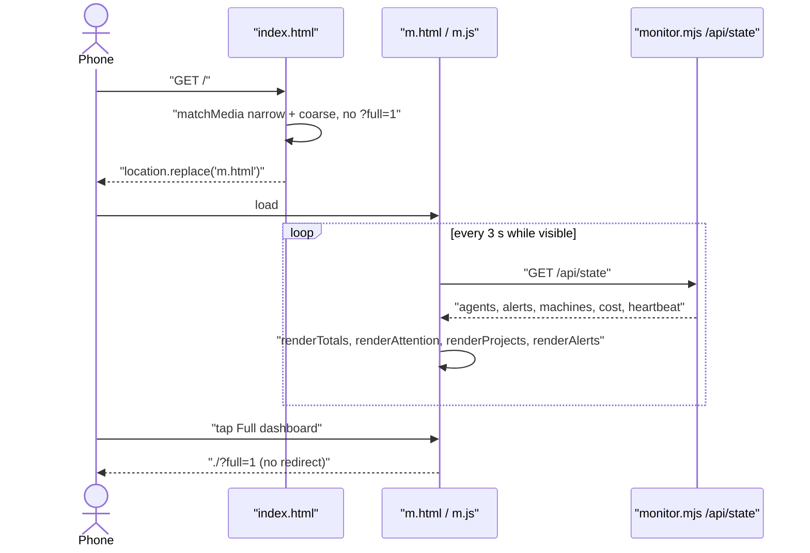
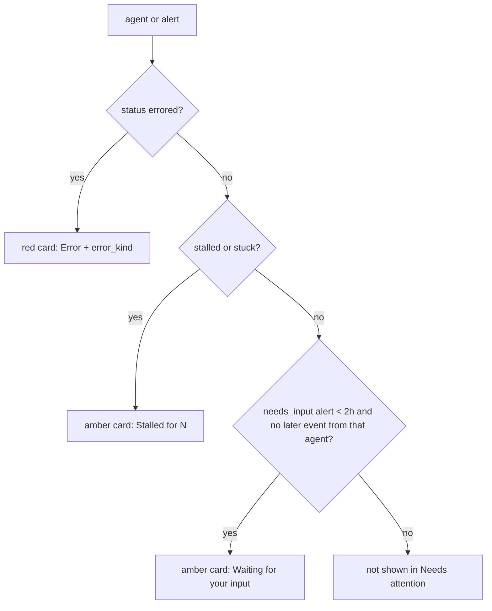

# Mobile view: projects and agents as a list on phones

## Summary
On a phone (390px) the particle graph becomes a ~1900px column where agents are scattered and hard to read. This adds `/m.html`, a list view of the same read-only `/api/state`: totals, a Needs-attention block, machine chips, an Active / All filter and one card per project with expandable agent rows. `index.html` sends phones there automatically, and `/?full=1` keeps the full dashboard. Stacked on #1 (upstream sync).

## Changes
- Mobile page (`ui/m.html`, `ui/m.css`, `ui/m.js`): vanilla JS that renders with `textContent` only and polls `/api/state` every 3 s while the tab is visible; colours come from the `theme.css` palette tokens, and it shares the `aos.theme` choice with the full dashboard
- Redirect (`ui/index.html`): an inline head script sends narrow screens with a coarse pointer to `m.html` unless `?full=1` is set
- Tests (`ui/m.test.mjs`, wired into `make test`): static checks (no innerHTML, GET-only, polling pauses in the background, tokens only, touch targets, the redirect and its escape hatch)
- Plugin copies regenerated with `make build` (`plugin/ui/*`)
- Docs: a Mobile view section in `docs/dashboard.md` and a CHANGELOG entry

## How it works
On load, `index.html` checks `matchMedia('(max-width:720px) and (pointer:coarse)')` and `location.replace`s to `m.html`, so the graph never loads on a phone. `m.js` fetches `/api/state` and renders four parts:
1. **Totals**: running / total agents, new tokens (input + output + cache write), and cost (exact from OTel when present, else the estimate).
2. **Needs attention**: errored agents, stalled agents, and `needs_input` alerts from the last 2 h whose agent has had no later event.
3. **Machine chips**: shown when `machines` has more than one entry.
4. **Project cards**: sorted by running count, then recency. Sessions come before subagents, and within each, errored > stalled > running > idle.

Expanded rows survive re-renders (their ids are kept in a `Set`).

## Verification
| Check | Command | Result |
|---|---|---|
| Full suite | `make test` | exit 0 |
| Mobile view static checks | `node ui/m.test.mjs` | mobile list view: all ok (12 checks) |
| Monitor suites | `node --test tests-monitor/*.test.mjs` | pass 75, fail 0 |
| MCP | `node plugin/mcp/test.mjs` | PASS 68 FAIL 0 |
| Real browser, 390x844 (iPhone 12 Pro preset), live data | preview at `/m.html` | list renders, expand works and survives polling, light and dark themes |
| Real browser, mocked state | `fetch` override with errored, stalled, needs-input and a second machine | Needs-attention cards, machine chips, `@laptop2` suffix, exact cost, Active filter all correct |
| Narrow desktop window keeps the full view | `matchMedia` in the preview (`coarse: false`) | no redirect |
| Through the LAN proxy | `curl -u … http://<host>.local:4380/{,m.html,m.js,m.css,api/state}` | all 200 |

## Risks and follow-ups
- The automatic redirect on a real phone (coarse pointer) was not exercised: the preview cannot emulate a touch pointer. The rule is the standard `pointer:coarse` media query; if it misfires, `/m.html` and `/?full=1` still work by hand.
- Subagents are not nested under their parent session, because `/api/state` has no parent link per agent. They are listed after the sessions of the same project and marked with ↳.
- Goal controls, replay and the timeline stay on the full dashboard only.
