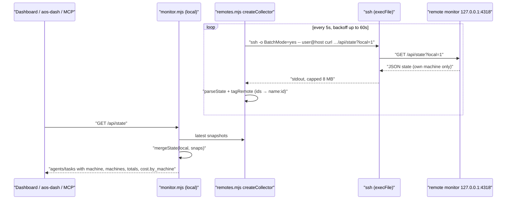

# Sync fork with upstream (28 commits, up to 40d2707)

## Summary
Fast-forwards this fork's `main` to `tomtomsatnav/agent-orchestration-standard` `main` at `40d2707`. The fork had no commits of its own past the merge base `2225018`, so this is a pure fast-forward: no conflicts, no local changes on top. It brings in the cross-machine view, exact cost from OpenTelemetry, the Guard view, more goal integrity signals, `aos-dash --json` and `make` support on Windows.

## Changes
- Cross-machine aggregation over SSH, opt-in and read-only (`remotes.mjs`, `monitor.mjs`, `ui/machines.js`, `docs/cross-machine.md`)
- Exact cost from Claude Code OTLP metrics on `POST /v1/metrics` (`otel.mjs`, `monitor.mjs`)
- Guard view: `aos-orch verify` verdicts on the dashboard, plus an opt-in SessionStart/Stop hook that verifies against the HEAD recorded at session start (`hooks/aos-guard.mjs`, `ui/guard.js`)
- Goals: anti-cheat integrity, self-checks, worker errors, version drift, protected tests and reviewer notes; goals also read from the legacy orch dirs (`ui/orch.js`, `monitor.mjs`)
- `aos-dash --json` snapshot (`cli/dash.mjs`)
- `make` on Windows: launcher shims, PowerShell-based stop/doctor, one opener per platform (`Makefile`, `scripts/aos.mjs`)
- Onboarding: per-port `make stop`, a friendlier empty state, a doctor path check (`README.md`, `scripts/aos.mjs`)
- Regenerated `plugin/` copies and new tests (`tests-monitor/*`, `ui/*.test.mjs`)

## How it works
Upstream's main new runtime flow is the cross-machine collector. When `remotes` is set in `config.json` (or `AOS_REMOTES`), `monitor.mjs` builds a collector with `createCollector`. Every 5 s, backing off up to 60 s on failure, the collector runs `ssh -o BatchMode=yes … -- <target> curl http://127.0.0.1:<port>/api/state?local=1` through `execFile`. It validates the reply with `parseState` and namespaces it with `tagRemote`. `mergeState` then folds all snapshots into the local `/api/state`.

## Verification
| Check | Command | Result |
|---|---|---|
| Full suite | `make test` | exit 0 |
| Monitor, verdicts, hooks, remotes, otel | `node --test tests-monitor/*.test.mjs` | 75 tests, 75 pass, 0 fail |
| MCP server | `node plugin/mcp/test.mjs` | PASS 68 FAIL 0 |
| Terminal dashboard | `node cli/test.mjs` | ok (84 ring cases, 6 list fallbacks) |
| UI suites (guard, machines, orch, needs-you, mobile, theme…) | part of `make test` | all ok |

## Risks and follow-ups
- After merging, run `make build && make restart` (or reinstall the plugin) so the running monitor picks up the new `monitor.mjs`.
- The Guard hook and cross-machine collector stay off until configured (`guard.repos`, `remotes`).
- Cosmetic, upstream: the `make test` line for the monitor suite greps `^# (pass|fail)`, but the current Node prints `ℹ pass`, so that line comes out empty even though the tests pass. Left untouched; worth reporting upstream.
